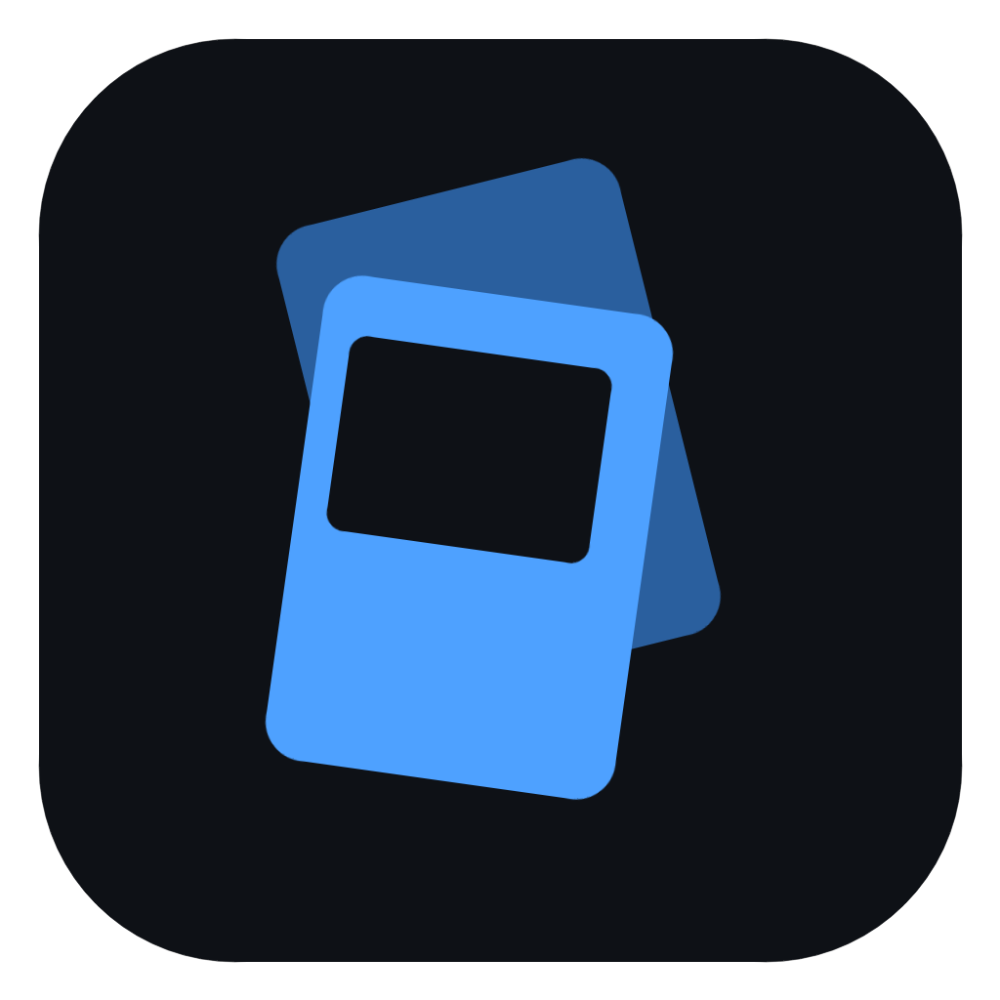

# CardScan

Bulk card scanning for Lorcana, Magic, Pokémon and Japanese Pokémon. A camera points down at a pile, you drop cards
on it one at a time, and each card is identified and added to your collection as it lands.

Runs on Linux and Windows. Any camera OpenCV can open works: a USB webcam, a phone in USB webcam mode, or a phone
streamed in as a virtual webcam (see [Camera](#camera)).

## Features

- Identifies each card as it lands, from its name, set code and collector number, with GPU OCR
- Lorcana, Magic, Pokémon and Japanese Pokémon, including showcase and alternate art printings
- A finish toggle for foils, reverse holos and holos while scanning
- Review page for unsure reads, a collection with TCGplayer prices in AUD, card search and set binders
- Built-in updater

## Install

Download the latest release from [Releases](https://github.com/Sirsyorrz/cardscan/releases/latest).

- Windows: the `-setup.exe`. Unsigned, so SmartScreen warns: "More info" then "Run anyway".
- Linux: the `.AppImage`, `chmod +x`, run.

The first launch installs Python and the scanner's packages into the app's data folder (about 2 GB to download).
It needs an NVIDIA GPU.

## Build from source

### Requirements

- Python 3 (tested on 3.14) and Node 22.18+ (the matcher runs its TypeScript directly)
- An NVIDIA GPU: OCR runs through `onnxruntime-gpu` on CUDA
- A camera on a stand or arm, pointing straight down

### Setup

```sh
python3 -m venv .venv
.venv/bin/pip install -r requirements.txt
.venv/bin/pip install --force-reinstall --no-deps opencv-python==5.0.0.93
```

The last line matters: RapidOCR pulls in `opencv-python-headless`, which shares the `cv2` folder and leaves it
without window support, so `--show` fails until the full build is reinstalled over it.

Then build the card database (`data/cards.db`, about 100 MB). It comes from Scryfall, TCGdex, Lorcast, tcgcsv and
Card Kingdom, and downloads are cached in `tools/cache/`:

```sh
.venv/bin/python tools/build_db.py
```

### Desktop app

`app/` is a desktop window over the scripts (Tauri + React) that runs the Python in this folder's `.venv`. Scan has
the camera picker, Start/Stop, the finish toggle and the live feed with the cards identified so far. Review,
Collection, Search and Binders are the pages described under [Reviewing](#reviewing), and Settings has the price
refresh and the card data rebuild.

It needs Rust and the [Tauri prerequisites](https://tauri.app/start/prerequisites/) for your OS.

```sh
cd app
npm install
./run.sh    # builds and starts it
```

### Installers

The installers bundle the scripts, uv, node and a seed `data/cards.db`, staged into `app/src-tauri/bundle-res/` by
`app/stage_bundle.py windows|linux`. On first run the app copies the scripts to its data folder
(`%LOCALAPPDATA%\dev.cardscan.app`, `~/.local/share/dev.cardscan.app`) and installs Python and the packages there;
the collection and captures live there too.

Releases are built by CI: bump the version in `app/package.json`, `app/src-tauri/tauri.conf.json` and
`app/src-tauri/Cargo.toml`, then push a `vX.Y.Z` tag. To build one locally:

```sh
cd app
python3 stage_bundle.py linux
npx tauri build --bundles appimage --config src-tauri/tauri.bundle.conf.json
```

Bundles are signed for the updater, so this needs `TAURI_SIGNING_PRIVATE_KEY` and its password set.

`app/release-windows.sh` cross-builds the Windows installer from Linux into
`app/src-tauri/target/x86_64-pc-windows-msvc/release/bundle/nsis/`. It expects a rustup with the `x86_64-pc-windows-msvc` target and cargo-xwin in
`~/.local/share/{rustup,cargo}-win`, and a native `makensis` built from the NSIS 3.13 source with the Windows
release's `Stubs`, `Plugins`, `Include` and `Contrib` in `~/.local/share/nsis-build/nsis/`. Set `CARDSCAN_WIN_TOOLS`
to use a folder other than `~/.local/share`.

## Scanning from the command line

The scripts work without the app. The source is a camera (`/dev/videoN` on Linux, a camera index on Windows) or a
recorded video file.

```sh
.venv/bin/python scan.py /dev/video0 --show             # q or Esc to stop
.venv/bin/python scan.py /dev/video0 --show --foil      # start with the finish toggle on foil
.venv/bin/python scan.py /dev/video0 --size 3840x2160   # ask the camera for 4K (default 1920x1080)
.venv/bin/python review.py                              # http://localhost:8765, alongside or afterwards
.venv/bin/python prices.py                              # refresh prices of everything owned
```

On Linux, `cat /sys/class/video4linux/video*/name` lists the cameras.

The window's top-right button (or F) sets the finish of the cards you drop next:

- Normal
- Foil / Reverse: Magic and Lorcana foil, Pokémon reverse holo
- Holo: Pokémon holo; Magic and Lorcana foil

A card gets the setting from when it landed. When a card doesn't come in that finish, it gets the nearest one it does.

Each run is a session. Its captures (straightened, upright) go to `captures/<session>/` with a labelled `sheet.jpg`,
and every capture is recorded in `data/collection.db` with a status:

- `added`: identified and counted in the collection. Confidence is high when the name and the set code or number
  agree, medium when one of them is fuzzy or missing or the printing was chosen from the artwork.
- `review`: no match, a low-confidence guess, or a capture that wasn't a clean card outline (a card stuck on its
  edge) unless it still matched with high confidence. Not counted until confirmed.
- `repeat`: the same name as the card before, i.e. the same card read again after it slid. A second copy is never
  added straight after the first; add extra copies by hand. The surer of the two reads keeps the printing.
- `rejected`: marked "not a card" on the review page.

`--record /tmp/session.mkv` saves the raw feed, and `scan.py /tmp/session.mkv --no-db --out /tmp/caps` replays it
without touching the collection, which is handy for tuning.

The collection only lives in `data/collection.db`, so back it up.

## Reviewing

- Review shows a session's captures next to the matched card. Pick another printing or search for the right card,
  set the finish, mark it not a card, or add more copies (arrows to move, Enter to add, X to reject, / to search).
  New captures appear while a scan is running, and Delete session drops a session with the cards it added.
- Collection lists what you own with prices, +/- per row, sortable columns and a price refresh. Click a card for its
  prices, stats and other printings. Prices are TCGplayer market prices converted to AUD.
- Search finds any card by name or by set and number (`DLR 44`, `044/103`, Lorcana `6 1`) with its price. Click one
  to add copies by hand.
- Binders lists every set with how many of its base slots you own. A secret rare or alternate art fills the base
  slot of the card with the same name. Tokens, promos and kits are behind a toggle. Opening a set shows its binder
  with missing cards dimmed, the cost to complete it, and the secret rares and alternates below.

## Camera

Whatever the camera, it has to be fixed above the pile pointing straight down: camera shake reads as motion and cards
get missed. Frame it so a card fills most of the picture, and keep glare and window light off it. Cards catch on
sloped tray walls and stand on their edge; a flat surface with a low lip, or dropping from just above the pile,
avoids that.

The collector number is the smallest print on the card, so sharpness matters more than anything else. A good 1080p
webcam with autofocus works; a phone camera usually reads better.

### USB webcam

Plug it in and use it directly. On Linux it's a `/dev/videoN`; on Windows, the app lists it by name.

### Android phone as a USB webcam

Android 14 and later can act as a USB webcam on many phones (Pixel and others): plug it in, pick "Webcam" in the USB
notification's options, then switch the preview on the phone to the back camera. It shows up like any webcam.
This mode tops out at 1920x1080.

### Other phones and webcam apps

Anything that turns a phone into a webcam device the OS sees (DroidCam, Iriun and the like, on Android or iPhone)
works the same way: pick it in the app's camera list, or pass its `/dev/videoN` or index to `scan.py`. Use the back
camera at the highest resolution and bit rate the app allows.

## How it works

- `watch.py` decides when a card has landed: the picture around the pile goes still and differs from the last
  still picture. `detect.py` finds the exact outline on a crop around it.
- `identify.py` reads the name strip both ways up (whichever gives a known name is up) and the collector strip,
  with RapidOCR on the GPU on a worker thread: about 0.5 s a card, twice that when the first read is unsure and a
  looser crop is tried. A rough capture that matches nothing gets searched again for the card at full resolution.
  Lorcana prints its name mid-card, so that strip is read too when the top and bottom don't settle a card, and a
  Lorcana location (printed sideways) has its collector line read turned a quarter either way.
- `matcher/matcher.ts` is a long-running Node process that resolves the OCR lines with `matcher/match.ts` against
  `data/cards.db`: name (fuzzy), set code and collector number.
- `art.py`: when the name and set were read but the collector number wasn't, the capture is compared with the
  official image of each printing in that set (showcase, borderless and so on). Images are cached in `data/images/`.
- `collection.py` keeps the collection: owned copies by card, finish and condition, plus every session and capture.
  Changing a capture's card or status moves its copy.
- `tools/build_db.py` builds `data/cards.db`. Pokémon sets that TCGplayer lists before TCGdex has them (new releases)
  come from TCGplayer's product data alone (ids `tcg-<productId>`, no artist or legality, images once TCGplayer has
  them); when a later build has the real cards, owned copies move over by product id.

## Development

```sh
npm install          # only fetches TypeScript for the typecheck
npm test             # matcher tests, against data/cards.db
npm run typecheck
```

## Stack

Python (OpenCV, numba, RapidOCR on onnxruntime-gpu), a Node/TypeScript matcher over SQLite, and a Tauri 2 + React
desktop app.
